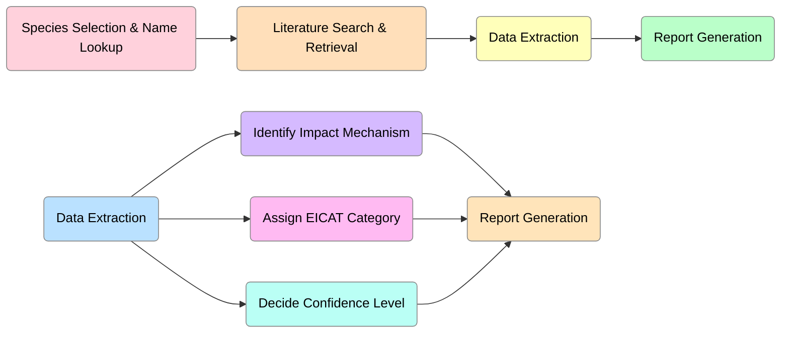
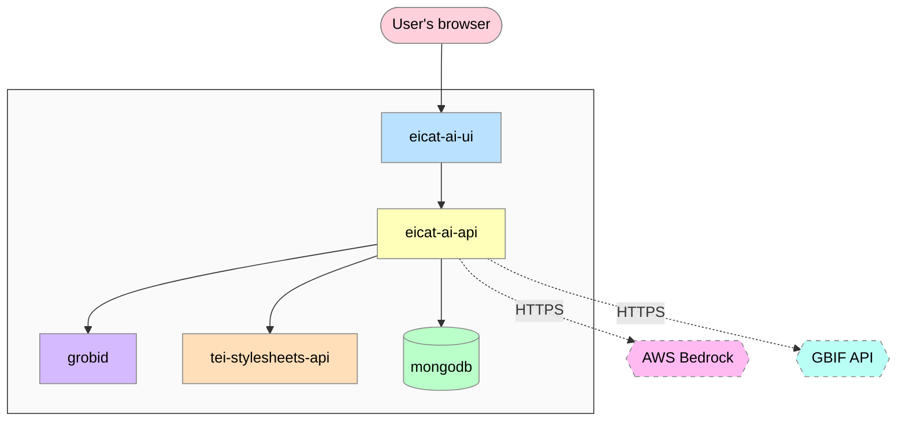
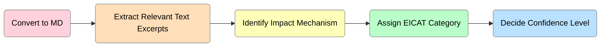
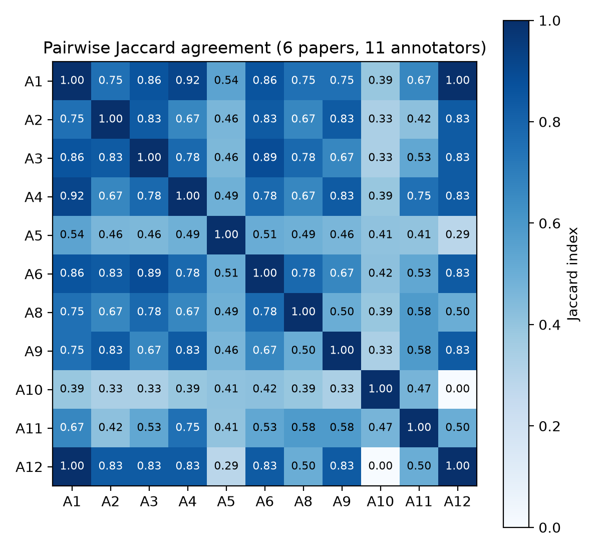
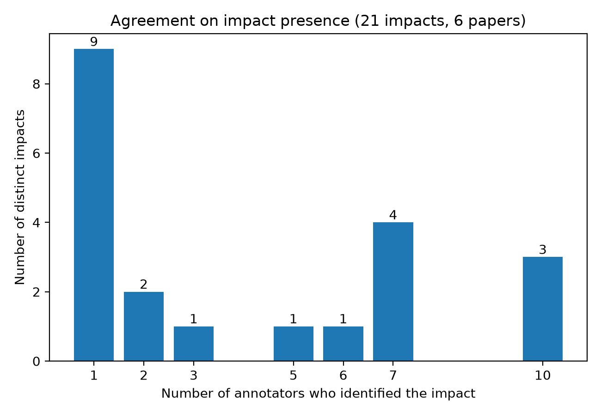
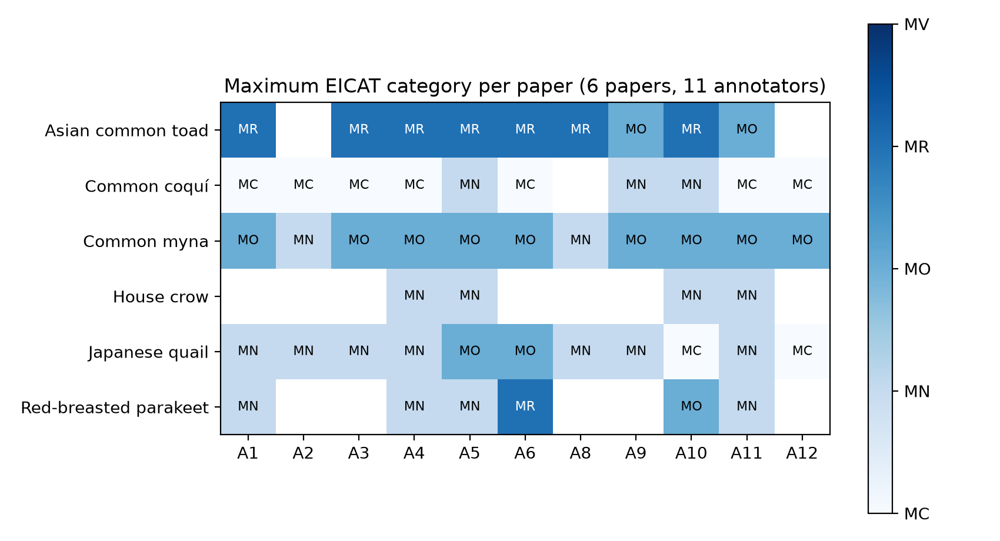

# EICAT-AI milestone report

**Project**: OneStop Task 4.4, LLMs for EICAT
**Prepared by**: UKCEH
**Status**: Working draft. Extend with additional evaluation data as it becomes available.
**Milestone**: Proof of concept that LLMs can perform EICAT assessments

## Executive summary

This milestone delivers a working proof of concept that large language models can perform [EICAT](https://iucn.org/sites/default/files/2023-02/eicat-guidelines-final-v1.1.pdf) (Environmental Impact Classification for Alien Taxa) assessment: given a species and a set of scientific papers, the system extracts evidence of ecological impact and classifies each finding against the EICAT standard, end to end, without a human in the loop. We have built a full working system: a FastAPI backend, a React web interface, a document-conversion pipeline, and an LLM extraction agent whose behaviour is grounded directly in the EICAT guidelines. It connects to a MongoDB-backed workflow that a user can drive from PDF upload to a structured impact report.

A small early pilot (5 papers) returned a mean F1 of 0.71 (recall 0.62, precision 0.87) against gold-standard [GISD](https://www.iucngisd.org/gisd/) data, supporting the case that an LLM can identify and classify impacts at a level worth building on. Alongside the system, we have also built the infrastructure needed to evaluate it rigorously at scale: a gold-standard dataset of over 2,000 impact records drawn from GISD, a stratified sampling pipeline for selecting representative test papers, and an automated evaluation CLI. A 163-case gold-standard test set and a 733-record stratified sample are ready to run through the evaluator. The priority now is running that full-scale evaluation to confirm the pilot result holds beyond 5 papers.

## Background

EICAT is the [IUCN's standard](https://doi.org/10.1111/ddi.12379) for classifying the impact of alien (non-native) species on native biodiversity. Assessors score each species on two axes: the **mechanism** of impact (twelve categories in total, for example competition, predation, disease transmission, and hybridisation) and its **severity**, on an ordinal scale from Minimal Concern (MC) through Minor, Moderate, Major, to Massive (MV), with a Data Deficient (DD) option where evidence is insufficient.

In practice, an assessment requires a person to read through the available literature for a species, find passages describing observed ecological effects, and judge which mechanism and severity category each piece of evidence supports. This is slow and does not scale well as the pool of eligible species and available literature grows. The premise of this project is that an LLM, given the EICAT guidelines and a paper's text, can perform the same extraction-and-classification task at comparable accuracy, turning a task that takes an assessor hours per species into one that takes minutes.

## System overview

The system runs as five containerised services (`docker-compose.yml`). A user works through the following flow:

1. The user looks up a species (backed by the [GBIF](https://www.gbif.org/) API) and uploads one or more PDFs of relevant literature.
2. Each PDF is converted to structured text via [GROBID](https://github.com/kermitt2/grobid) (PDF → TEI XML) and a TEI-to-Markdown conversion step.
3. The user starts an analysis; the extraction agent processes each paper's Markdown text and returns a set of typed impact records.
4. Each impact record is displayed per paper, showing the mechanism, EICAT category, reversibility, confidence rating, supporting quotation, and reasoning, and can be reviewed against the source text.

## Technical architecture

The system runs as five [Docker Compose](https://docs.docker.com/compose/) services on a shared network, plus two external APIs called directly by the backend:

Everything inside the box is a container defined in `docker-compose.yml`, all on the same bridge network; the two dashed nodes outside it are external HTTPS APIs the backend calls directly. `eicat-ai-api` is the only service that talks to Bedrock, GBIF, GROBID, the TEI converter, and MongoDB: the UI only ever calls the API.

#### Backend

`eicat-ai-api` is a [FastAPI](https://fastapi.tiangolo.com/) service (Python 3.13) built around [Pydantic AI](https://ai.pydantic.dev/) for the LLM agent layer. Routers separate concerns for papers, analyses, and species lookup. Data extraction is handled by a typed Pydantic AI agent whose output schema is a list of `Impact` objects. The schema itself encodes the EICAT standard as Python enums for `Category` (MC/MN/MO/MR/MV/DD) and `Mechanism` (the twelve IUCN-defined mechanisms), so the model's output is structurally constrained, not just prompted, to stay within valid EICAT values.

#### Knowledge distillation

Rather than retrieval-augmented generation over the guidelines document, the EICAT guidelines have been distilled directly into the agent's system prompt and into the typed schema: category decision criteria, mechanism definitions, and confidence/reversibility rules are all encoded as first-class instructions and enum descriptions the model sees on every call. This keeps the pipeline simple (no vector store, no retrieval step) at the cost of prompt length.

#### LLM provider

The system runs on [AWS Bedrock](https://aws.amazon.com/bedrock/). The default extraction model is [Claude 3.7 Sonnet](https://www.anthropic.com/news/claude-3-7-sonnet) (`bedrock:anthropic.claude-3-7-sonnet-20250219-v1:0`); [Amazon Nova Lite](https://aws.amazon.com/nova/) is also used, in evaluation, as a lighter, cheaper judge model. Running entirely on Bedrock keeps model access, data handling, and cost within AWS rather than a third-party API.

#### Document pipeline

GROBID, a dedicated PDF-to-structured-text service, converts uploaded PDFs to TEI XML; a small internal FastAPI service then converts TEI XML to Markdown via an HTML intermediate step. This two-stage conversion was chosen over asking the LLM to parse raw PDF text directly, since GROBID's TEI output reliably separates body text from references, tables, and figure captions.

#### Persistence

[MongoDB](https://www.mongodb.com/), via [Beanie](https://beanie-odm.dev/)/[Motor](https://motor.readthedocs.io/), stores papers (including converted Markdown), analyses, and their extracted impact results.

#### Frontend

The frontend is a [React](https://react.dev/) 18 + [TypeScript](https://www.typescriptlang.org/) single-page application built with [Vite](https://vite.dev/) and [MUI](https://mui.com/), using [Zustand](https://github.com/pmndrs/zustand) for state and a typed API client against the backend. It provides pages for managing papers, running analyses, and reviewing extracted impacts against source evidence.

## Evaluation plan

Evaluating extraction and classification quality is as much of a deliverable as the system itself. The gold standard is the GISD EICAT export, filtered and cleaned to 2,133 impact records across 1,096 invasive species and 818 referenced texts; this is the ground truth against which the system's output is compared. A stratified sampling pipeline (`utils/`) selects test papers to match the joint distribution of ecological system, EICAT category, and impact mechanism in that gold-standard data, so the evaluation set doesn't skew toward easy or overrepresented cases. It has produced a 733-record stratified sample and a curated 163-case gold-standard test set (453 individual gold impact records), each with source text, expected impacts, and species metadata, ready to run through the automated evaluator.

An `eicat-eval` CLI (fetch, prepare, run) benchmarks the extraction pipeline against the gold standard and reports precision, recall, and F1. The current evaluator matches predicted-to-gold impacts by mechanism overlap; the evaluation protocol also specifies a semantic LLM-as-judge matching step for a more accurate comparison, which is designed but not yet wired in. A separate inter-annotator agreement (IAA) study measures how consistently human annotators agree with each other on the same evidence, giving us a ceiling to evaluate the LLM against rather than assuming perfect human agreement.

The guiding hypotheses for this evaluation are that the LLM will identify impacts with performance approaching human annotators, that it will assign categories and confidence ratings accurately given correctly identified impacts, and that gaps between LLM and gold-standard performance will partly track cases where human annotators also disagree with each other.

## Initial results

A small pilot run over 5 papers gave a mean recall of 0.62, precision of 0.87, and F1 of 0.71 against gold-standard GISD data: early evidence that the extraction agent is finding real impacts and classifying most of them correctly, not just producing plausible-looking output. This is a proof-of-concept result rather than a validated performance figure: 5 papers is too small a sample to be conclusive on its own, so the next step is running the same evaluation over the 163-case gold-standard test set to confirm the result holds at scale.

### Human baseline: how much do annotators agree with each other?

Before comparing the LLM to a gold standard, it's worth knowing how much two humans doing the same task would disagree. Batch A of the IAA study pooled 12 annotators' evidence quotes across 6 papers and used an LLM to cluster quotes describing the same underlying impact (`eval/align_impacts.py`), giving 24 distinct impacts to measure agreement over. Annotators are referred to by anonymous ids (A1, A2, ...) throughout, never by name or initials.

Agreement between any two annotators varies widely, from 0.00 up to 1.00 [Jaccard](https://doi.org/10.1111/j.1469-8137.1912.tb05611.x), with a mean of 0.54. Almost half of the 24 impacts were flagged by only one annotator.

[Krippendorff's alpha](https://repository.upenn.edu/entities/publication/034a6030-c584-4d14-9d3d-7b7e8d16df20) across all annotators comes out at 0.34, Fair on the [Landis & Koch (1977)](https://doi.org/10.2307/2529310) scale used in [`site/eval-protocol.qmd`](eval-protocol.html). Alpha sits well below the mean Jaccard score because it corrects for chance agreement and is pulled down by the large share of singleton impacts, largely cases of one annotator splitting or noticing something the others didn't. The practical implication: a system's disagreement with any single gold-standard annotator is not purely system error, since annotators disagree with each other at a similar rate on this same task. This baseline is what LLM evaluation scores should be read against once the full-scale run is complete.

A second, independent angle asks a coarser question: for each paper, do annotators at least agree on its *maximum* EICAT category, the single most consequential number in an assessment? `eval/category_agreement.py` reads the category column directly (no LLM step needed).

No paper in this batch had unanimous agreement on its maximum category: annotators' assessments spread by 1.7 category steps on average where they disagreed, for example "Asian common toad" splits between Moderate and Major, and "Japanese quail" ranges all the way from Minimal Concern to Major. Krippendorff's alpha here is 0.54, Moderate agreement, better than the 0.34 for impact presence but still short of Substantial. Read together, both angles point the same way: EICAT category boundaries carry real ambiguity even for trained human annotators, which sets a ceiling on how closely any system, LLM or human, should be expected to match a single gold-standard label.

*(Generated by `eval/report_iaa.py`, re-run after `eval/align_impacts.py` and `eval/category_agreement.py` to refresh.)*

## Current limitations

As a proof of concept, the system demonstrates the full pipeline works and produces credible results on a small sample; it has not yet been validated at scale. We have not yet run the large-scale evaluation, and the evaluator currently checks mechanism-level matching rather than the full semantic matching described in the evaluation protocol. These are the next steps to move from proof of concept to a validated system, not open design questions.

## Next steps

*(placeholder, to be filled in)*

- [ ]
- [ ]
- [ ]

## References

### Academic sources

- Hawkins, C.L., Bacher, S., Essl, F., Hulme, P.E., Jeschke, J.M., Kühn, I., Kumschick, S., Nentwig, W., Pergl, J., Pyšek, P., Rabitsch, W., Richardson, D.M., Vilà, M., Wilson, J.R.U., Genovesi, P. and Blackburn, T.M. (2015). Framework and guidelines for implementing the proposed IUCN Environmental Impact Classification for Alien Taxa (EICAT). *Diversity and Distributions*, 21(11), 1360-1363. [https://doi.org/10.1111/ddi.12379](https://doi.org/10.1111/ddi.12379)
- IUCN (2020). Guidelines for using the IUCN Environmental Impact Classification for Alien Taxa (EICAT) Categories and Criteria, Version 1.1. IUCN, Gland, Switzerland and Cambridge, UK. [https://iucn.org/sites/default/files/2023-02/eicat-guidelines-final-v1.1.pdf](https://iucn.org/sites/default/files/2023-02/eicat-guidelines-final-v1.1.pdf)
- Landis, J.R. and Koch, G.G. (1977). The measurement of observer agreement for categorical data. *Biometrics*, 33(1), 159-174. [https://doi.org/10.2307/2529310](https://doi.org/10.2307/2529310)
- Krippendorff, K. (2011). Computing Krippendorff's Alpha-Reliability. *Departmental Papers (ASC)*, University of Pennsylvania. [https://repository.upenn.edu/entities/publication/034a6030-c584-4d14-9d3d-7b7e8d16df20](https://repository.upenn.edu/entities/publication/034a6030-c584-4d14-9d3d-7b7e8d16df20)
- Jaccard, P. (1912). The distribution of the flora in the alpine zone. *New Phytologist*, 11(2), 37-50. [https://doi.org/10.1111/j.1469-8137.1912.tb05611.x](https://doi.org/10.1111/j.1469-8137.1912.tb05611.x)

### Data sources and standards

- GISD (Global Invasive Species Database). IUCN SSC Invasive Species Specialist Group. [https://www.iucngisd.org/gisd/](https://www.iucngisd.org/gisd/)
- GBIF (Global Biodiversity Information Facility). [https://www.gbif.org/](https://www.gbif.org/)
- Coole, M. Evaluation protocol. UKCEH OneStop project documentation. Rendered at [eval-protocol.html](eval-protocol.html), source at `site/eval-protocol.qmd`.

### Software and services

- FastAPI. [https://fastapi.tiangolo.com/](https://fastapi.tiangolo.com/)
- Pydantic AI. [https://ai.pydantic.dev/](https://ai.pydantic.dev/)
- AWS Bedrock. Amazon Web Services. [https://aws.amazon.com/bedrock/](https://aws.amazon.com/bedrock/)
- Anthropic (2025). Claude 3.7 Sonnet. [https://www.anthropic.com/news/claude-3-7-sonnet](https://www.anthropic.com/news/claude-3-7-sonnet)
- Amazon Nova Lite. Amazon Web Services. [https://aws.amazon.com/nova/](https://aws.amazon.com/nova/)
- GROBID. [https://github.com/kermitt2/grobid](https://github.com/kermitt2/grobid)
- MongoDB. [https://www.mongodb.com/](https://www.mongodb.com/)
- Beanie (ODM). [https://beanie-odm.dev/](https://beanie-odm.dev/)
- Motor (async MongoDB driver). [https://motor.readthedocs.io/](https://motor.readthedocs.io/)
- React. [https://react.dev/](https://react.dev/)
- TypeScript. [https://www.typescriptlang.org/](https://www.typescriptlang.org/)
- Vite. [https://vite.dev/](https://vite.dev/)
- MUI. [https://mui.com/](https://mui.com/)
- Zustand. [https://github.com/pmndrs/zustand](https://github.com/pmndrs/zustand)
- Docker Compose. Docker Inc. [https://docs.docker.com/compose/](https://docs.docker.com/compose/)

## Appendix

*(placeholder for additional evaluation data, statistics, and figures as they become available)*
