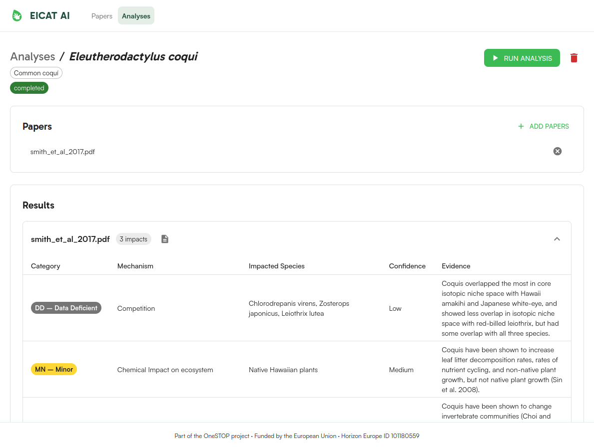

## EICAT in one slide

::: notes
EICAT is the IUCN standard for scoring how badly an alien species harms native biota. Each piece of evidence gets one of twelve mechanisms, such as competition, predation or hybridisation, and a severity from Minimal Concern up to Massive. A species is then scored by its worst documented impact. The scheme is simple; the evidence behind it is the hard part.
:::

## The bottleneck is reading

::: {.content-visible when-format="html"}
[Band width = impact records · colour = EICAT category · Other = bio-fouling, physical impact, interaction with other aliens]{.muted style="font-size: 0.5em"}
:::

::: notes
GISD, our gold standard, holds about 1,200 EICAT impact records from 800 references, and every one of those rows is a person reading a paper and judging mechanism and severity. Follow the bands: 71 percent of records are terrestrial, competition and predation together account for 60 percent, and the largest single category is Data Deficient at 37 percent. Major and Massive impacts are only 5 percent of records. Keep those rare classes in mind, because they come back to haunt us in the results.
:::

# Building EICAT-AI {.section background-image="assets/section-deer.jpg"}

::: notes
So, can we hand some of that reading to a language model?
:::

## From PDF to EICAT impact records

::: notes
The pipeline is deliberately boring, because boring is reproducible. PDFs go through GROBID for clean body text, then to an LLM agent. Rather than retrieval over the guidelines, we distilled EICAT directly into the prompt and into a typed output schema, so the model physically cannot invent a category. The latest version adds seven worked GISD examples. Everything runs on AWS Bedrock in five containers.
:::

## Every impact is traceable to its evidence

:::: {.columns}
::: {.column width="38%"}
- Upload papers for a species
- One click runs the analysis
- Each record: **category**, **mechanism**, **confidence**, **evidence quote**
- Assessor reviews, rather than reads from scratch
:::
::: {.column width="62%"}

:::
::::

::: notes
This is the web app. The key design choice is that every impact the model reports carries the exact quote it relied on, so an assessor can verify it in seconds. The intended use is triage and drafting, with the expert still signing off.
:::

# Evaluating against GISD {.section background-image="assets/section-deer.jpg"}

::: notes
Building it is the easy half. Does it actually agree with the experts?
:::

## Evaluation design

::: notes
We held out 60 papers that were never touched during prompt development. Each one goes through the running app exactly as a user upload would. Free-text impacts can't be matched by string comparison, so an independent model, GPT-5.5, pairs each extracted impact with the GISD impact describing the same effect. We report F2, which weights recall over precision: for an assessor, a missed impact costs more than a spurious one they can discard.
:::

## Best configuration on unseen papers

::: notes
Headline numbers for the best setup, Claude Haiku 5.5 with the improved prompt. It finds three-quarters of the impacts GISD records. Mechanism labels are right about two-thirds of the time, category labels about half. And for three-quarters of papers, its most severe category is within one step of GISD's.
:::

## Two models, two prompts: all land at F2 ≈ 0.6

::: notes
We compared two Bedrock models, Haiku 5.5 and Nova Lite, each with the original and the improved prompt. They all land at an F2 of about 0.6, and the confidence intervals overlap. The improved prompt mostly moves Haiku along the precision-recall trade-off: it finds more and over-reports more. The cost is roughly 0.4 cents per paper.
:::

## Accuracy by mechanism and by category

:::: {.columns}
::: {.column width="50%"}

:::
::: {.column width="50%"}

:::
::::

::: notes
Accuracy is far from uniform. Predation and competition, which papers usually state outright, are above 85 percent. Chemical impacts and grazing, which need inference, sit around 20 percent. For categories, Minor and Data Deficient are recognised well; Minimal Concern and Major less so. Mind the small n on several spokes.
:::

## Severity: usually close, rarely exact

::: notes
For the paper's worst impact, 38 percent are exact and another 37 percent are one category out. So the model is in the right neighbourhood, but rarely at the right address. That raises the obvious question: how often do human experts land at the same address?
:::

# Inter-annotator agreement {.section background-image="assets/section-deer.jpg"}

::: notes
To judge the model fairly, we need a human baseline.
:::

## Humans agree fairly on impacts, substantially on severity

::: notes
Eleven annotators, six experienced in EICAT and five not, each assessed the same six papers. Agreement on which impacts are present is only fair, with alpha at 0.39. Agreement on each paper's worst category is substantial, at 0.69, yet only one of the six papers was unanimous. Within-group alpha for impacts looks low because the experienced annotators agree on almost everything they found, which leaves alpha little to credit; the next slide shows that more directly.
:::

## Experience shows in which impacts are found

::: notes
Each dot is a pair of annotators, scored by how much the impacts they found overlap. Experienced pairs overlap at 0.81, against 0.48 for inexperienced pairs; an exact permutation test puts that at p = 0.026. With groups of six and five this is indicative rather than definitive, but it suggests EICAT experience mainly helps people agree on which impacts count.
:::

## Take-home

- **Finds ¾ of GISD impacts** for under a cent per paper
- **Over-reports**: precision 0.36, so an expert stays in the loop
- **Mechanism ✓, severity ~**: within one category for 75% of papers
- **Humans aren't unanimous either**: impacts α = 0.39, severity α = 0.69
- **Next**: larger IAA round, compare the model directly against human agreement, sharpen precision

::: notes
To summarise: the model is a diligent but over-enthusiastic research assistant. It finds most of what the experts found and cites its evidence, but it over-reports and its severity calls need checking. Human experts are not unanimous either, especially on which impacts a paper contains. Next we will scale up the agreement study, so the model can be benchmarked against the human ceiling rather than a single gold standard.
:::

:::: {.content-visible when-format="html"}

## Thank you {.closing background-image="assets/closing-ants.jpg"}

Questions welcome

{.eu-closing .nostretch}

::: {.funding}
OneSTOP receives funding from the European Union's Horizon Europe Research and Innovation Programme (ID No 101180559). Views and opinions expressed are those of the author(s) only and do not necessarily reflect those of the European Union or the European Research Executive Agency (REA). Neither the EU nor REA can be held responsible for them.
:::

::: notes
Thank you. The code, evaluation scripts and these figures are all in the EICAT-AI repository. Happy to take questions.
:::

::::

:::: {.content-visible unless-format="html"}

## Thank you

Questions welcome

OneSTOP receives funding from the European Union's Horizon Europe Research and Innovation Programme (ID No 101180559). Views and opinions expressed are those of the author(s) only and do not necessarily reflect those of the European Union or the European Research Executive Agency (REA). Neither the EU nor REA can be held responsible for them.

::: notes
Thank you. The code, evaluation scripts and these figures are all in the EICAT-AI repository. Happy to take questions.
:::

::::
